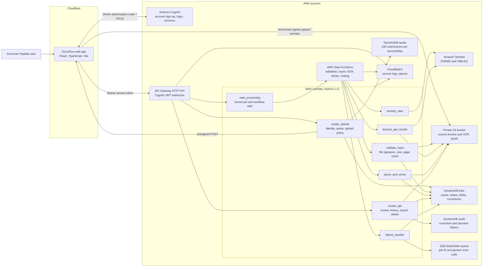

# Architecture

DocuFlow OCR is an Accounts Payable invoice intake and review application. Cloudflare Pages serves the React client; AWS provides customer identity, the authenticated API, private document storage, OCR orchestration, and durable review state. Terraform defines the AWS resources.

## Containers

## Runtime Flow

1. A customer signs up or signs in through Cognito managed login. The browser uses OAuth authorization code with PKCE and keeps tokens in tab-scoped session storage.
2. The browser sends the Cognito access token to API Gateway. API Gateway verifies the JWT; Lambda derives the workspace owner from the verified `sub` claim. The request body cannot choose an owner.
3. `POST /uploads` validates filename, declared MIME type, byte count, SHA-256, and idempotency key. It creates an owner-scoped job, applies a 5-submission-per-account daily quota, then returns a 15-minute S3 presigned POST bounded to 10 MB, the declared content type, and the checksum metadata.
4. The browser uploads directly to the private S3 bucket and calls `POST /jobs/{job_id}/start`. If an upload is interrupted or its response is lost, `POST /jobs/{job_id}/upload-url` checks the owner and checksum, then either confirms the object is already present or issues a fresh upload form. The start API checks ownership and object presence, makes the state transition conditional, then starts Step Functions with an attempt-specific execution name.
5. `validate_input` checks the actual S3 size, MIME metadata, file signature, PDF encryption, page count, and SHA-256 of the stored bytes. PDFs are limited to 5 pages; PNG and JPEG are single-page inputs. Invalid or changed files fail before Textract starts.
6. Step Functions starts asynchronous Textract `StartDocumentAnalysis`, waits 15 seconds between status checks, and stops after 120 polls. Transient Lambda errors retry; workflow failures set a generic customer-visible failure code and send a minimal message to the SQS dead-letter queue.
7. Textract results are stored in S3. `parse_and_score` normalizes invoice header fields and retains confidence plus source-page geometry when Textract provides it. Complete high-confidence results become `COMPLETED`; uncertain or incomplete results become `NEEDS_REVIEW`.
8. The authenticated review API returns only the customer's jobs. The browser can request a five-minute signed URL for the source, save corrections, inspect the correction/decision history, and approve or reject the invoice.
9. `GET /exports/invoices.csv` exports only `APPROVED` records. Saved corrections take precedence over extracted values; formula-like cell values are escaped. `DELETE /jobs/{job_id}` prevents processing/deletion races, removes the source and all attempt-scoped OCR objects, clears audit history, then removes the job.

## API Routes

| Method | Route | Access |
| --- | --- | --- |
| `GET` | `/health` | Public health status |
| `POST` | `/uploads` | Authenticated customer |
| `POST` | `/jobs/{job_id}/upload-url` | Authenticated owner; recover interrupted upload |
| `POST` | `/jobs/{job_id}/start` | Authenticated owner |
| `GET` | `/jobs` | Authenticated owner; paginated history |
| `GET` | `/jobs/{job_id}` | Authenticated owner |
| `GET` | `/jobs/{job_id}/document` | Authenticated owner; five-minute URL |
| `GET` | `/jobs/{job_id}/history` | Authenticated owner |
| `PATCH` | `/jobs/{job_id}/review` | Authenticated owner |
| `POST` | `/jobs/{job_id}/decision` | Authenticated owner |
| `DELETE` | `/jobs/{job_id}` | Authenticated owner |
| `GET` | `/exports/invoices.csv` | Authenticated owner |

## Deployment Shape

- Cloudflare Pages serves a static Vite build. The build requires `VITE_API_BASE_URL`, `VITE_COGNITO_AUTH_DOMAIN`, and `VITE_COGNITO_CLIENT_ID`; the OAuth redirect defaults to the current site origin plus `/auth/callback`.
- Terraform creates an email-verified Cognito user pool and public app client, API Gateway JWT authorizer, Lambda functions, Step Functions, S3, DynamoDB jobs/audit/quota tables, SQS DLQ, IAM, and CloudWatch resources.
- The frontend workflow builds for pull requests and pushes. It skips the Pages deploy unless Cloudflare credentials and product connection variables are present.
- `make package` vendors `pypdf` only into the `validate_input` Lambda package. All functions receive a shared execution role scoped to this application's resources; per-function roles are not implemented.
- This repository's AWS resources are infrastructure definitions, not evidence of a live deployment. Configure and deploy the AWS stack and frontend separately.

## Data And Security Boundaries

- Each Cognito `sub` is an isolated customer workspace. Team members, shared organizations, and role-based access are not implemented.
- API Gateway protects every route except `/health`; each Lambda customer route also requires the JWT subject claim. Ownership is checked for job reads, source URLs, review changes, history, deletion, and exports. Workflow writes are conditional on the job owner.
- S3 blocks public access, uses server-side encryption, denies non-TLS transport, and expires all objects after 30 days. Upload and preview URLs are time-limited bearer capabilities.
- DynamoDB uses on-demand billing and TTL on jobs, audit entries, and daily quota records. TTL processing is asynchronous; it is not an exact deletion-time guarantee.
- CloudWatch API access logs omit request bodies. Step Functions does not log execution input/output. Failure records and SQS messages omit invoice content and extraction values.
- There is no payment/entitlement system, external accounting integration, configurable retention, backup/restore workflow, or compliance certification.

## Constraints

- Inputs: PDF, PNG, or JPEG only; at most 10 MiB, 25 PDF pages, and 100 submissions per account per UTC day.
- Processing can take up to roughly 30 minutes before the workflow stops polling. Status remains visible in the customer workspace; retry is available for transient failures.
- The parser currently focuses on invoice header fields. It does not export invoice line items, reconcile against purchase orders, or write to an accounting system.
- Textract charges per analyzed page. Cognito's default email delivery has account-level quotas; assess delivery needs before opening account creation broadly.
- Unit tests and controlled browser tests do not replace a deployed Cognito/API/S3/Step Functions integration test. A real end-to-end release check requires the AWS resources and valid user credentials.
